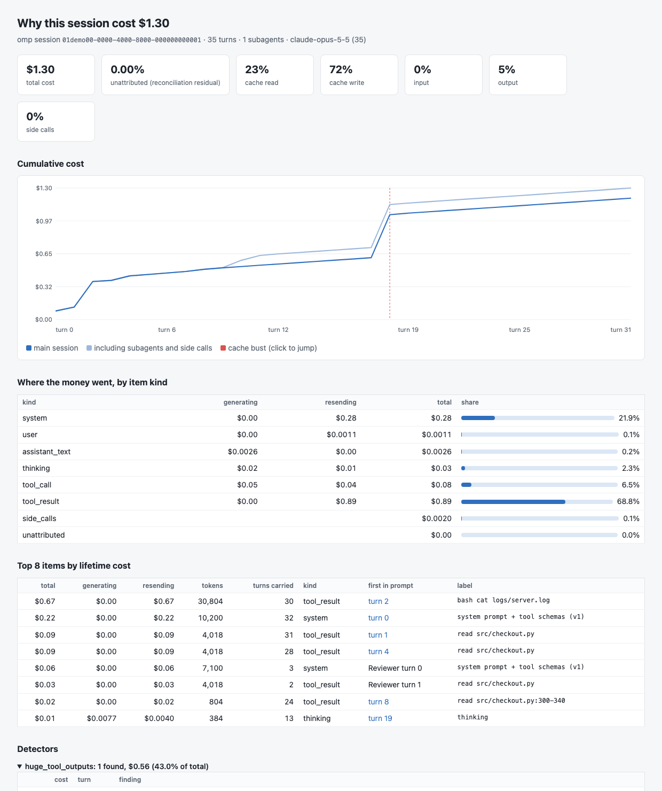

# context-ledger

Find out **why** a coding-agent session cost what it did, not just how much.

Coding agents resend the whole conversation on every request. With prompt caching, most of
the bill is cache reads and cache writes of context the model has already seen. A 10,000-token
tool output that stays in context for 200 more turns is billed 200 more times. context-ledger
reads omp and Claude Code session logs and charges every piece of context (system prompt,
user message, thinking block, tool call, tool result) its **lifetime cost**: what it cost to
generate plus what it cost to carry in every later prompt, priced at the rates the log
recorded for each request. It then runs rule-based waste detectors over the result and
re-prices the session under "what if" policies.

Everything runs locally, reads logs read-only, and never touches the network.



*Rendered from the synthetic session in [`tests/fixtures/demo`](tests/fixtures/demo); the
full page is [`docs/demo-report.html`](docs/demo-report.html).*

## A worked example (synthetic)

The demo session is 35 billed requests. The agent fixes a bug in a web handler and a
reviewer subagent checks the fix. It cost $1.30:

```text
$ context-ledger report tests/fixtures/demo/demo-session.jsonl
Total $1.30; attributed to items $1.30, unattributed $0.00 (0.00%), token residual 0.00% of prompt tokens
Spend by billing component: cache read 22.9%, cache write 71.8%, input 0.0%, output 5.1%, side calls 0.1%

Top 6 items by lifetime cost:
      total   tokens  turns  kind                   at  label
      $0.67   30,804     30  tool_result        turn 2  bash cat logs/server.log
      $0.22   10,200     32  system             turn 0  system prompt + tool schemas (v1)
      $0.09    4,018     31  tool_result        turn 1  read src/checkout.py
      $0.09    4,018     28  tool_result        turn 4  read src/checkout.py
      ...
Detectors (cost = money the pattern is responsible for):
  huge_tool_outputs        1 found       $0.56   43.0%
  cache_busts              1 found       $0.41   31.2%
      cache TTL expired: 1 busts, $0.41
          $0.41  turn 18    turn 18: 51,923 cached tokens rewritten (cache TTL expired, gap 120 min)
  repeated_reads           1 found       $0.09    6.8%
  failed_tool_calls        1 found       $0.02    1.4%
      3 failed calls, 1 retry loops
```

Only 5% of the bill was generating anything. One `cat` of a server log, about 31k tokens,
cost $0.67 because it was carried through 30 more requests. That is half the session, for
a log the agent used once to find a single traceback line. Capping tool output at 5,000
tokens would have saved $0.56. The user's two-hour break let the one-hour cache expire, so
52k tokens had to be written to cache again ($0.41). Re-reading a file that was still in
context cost $0.09. None of this shows up in a token total.

## Install

Python 3.11+, no runtime dependencies.

```sh
uvx --from git+https://github.com/cwilson-111/context-ledger context-ledger summary ~/.omp/agent/sessions
# or
pipx install git+https://github.com/cwilson-111/context-ledger
```

From a clone: `uv sync && uv run context-ledger --help`.

## Usage

```sh
# One session (subagent transcripts in the sibling directory are included)
context-ledger report ~/.omp/agent/sessions/<project>/<session>.jsonl
context-ledger report <session.jsonl> --html report.html   # self-contained HTML
context-ledger report <dir>            --html reports/      # one HTML file per session

# Every session under a directory: which patterns cost the most overall
context-ledger summary ~/.omp/agent/sessions
context-ledger summary ~/.claude/projects --json            # machine-readable

# Options: --top N (rows per table), --json, --prices prices.json
```

| harness | logs | status |
|---|---|---|
| omp (Oh My Pi) | `~/.omp/agent/sessions/**/*.jsonl`, including subagent files and compactions | supported; costs are read from the log |
| Claude Code | `~/.claude/projects/**/*.jsonl`, including `subagents/` and sidechains | supported; priced from tokens (the transcript records no cost) |
| Codex | | not yet supported |

`--prices` takes `{"model": {"input": 4, "output": 20, "cache_read": 0.2, "cache_write_1h": 8}}`
(USD per million tokens) and only matters where a log has tokens but no recorded cost.
The built-in table ([`pricing.py`](src/context_ledger/pricing.py)) was checked against costs
the harnesses recorded themselves.

## How attribution works

1. **Parse** each billed request (a *turn*) and the exact ordered context it was sent with:
   the system block, then the conversation from the root or the last compaction. This
   handles omp's parent-linked entry tree, compactions, pruned tool results and stripped
   thinking blocks, and Claude Code's streamed multi-line responses and parallel tool
   results.
2. **Size every item** from recorded usage wherever possible. An assistant message is
   resent at its recorded output token count. The prompt-size difference between two turns,
   minus everything already sized, is exactly the size of what is new; one new item gets it
   outright, several share it in proportion to their estimates. On the author's logs 99% of
   resend cost sits on sizes pinned this way. The rest uses `ceil(chars / 2.24)`, fitted on
   held-out real deltas: median error 10% against 46% for chars/4 (see
   [FINDINGS](docs/FINDINGS.md#token-counts-and-the-estimator)).
3. **Charge positionally.** Prompt caching is prefix-based: a request's first
   `cache_read` tokens are billed as cache reads, the next `cache_write` tokens as cache
   writes, and the uncached tail as input. Each item pays for the tokens it occupies in
   each region at that turn's recorded per-token rate. Output cost goes to the parts the
   turn generated.
4. **Reconcile.** Per turn, item costs plus the unattributed remainder equal the recorded
   cost exactly (a tested invariant). The unattributed share is reported as the
   reconciliation residual: 0.009% on 5,591 real omp requests and 0.00% on Claude Code.

### Detectors

Each is a small pure function in [`detectors.py`](src/context_ledger/detectors.py).

| detector | fires when | cost reported |
|---|---|---|
| `repeated_reads` | the identical read request (same path and range) was made earlier, that earlier result is still in the prompt when the new one arrives, and the file was not written in between | the redundant call and result, generation plus lifetime |
| `huge_tool_outputs` | a tool result is at least 5,000 tokens | lifetime cost of the part above 5,000 tokens |
| `failed_tool_calls` | a tool result is an error; consecutive failures of one tool are grouped as a retry loop | the failing calls and their error results |
| `cache_busts` | a turn's cache read falls short of the prefix the previous turn cached by at least 2,048 tokens and 10% (excluding the first turn after a compaction) | the lost tokens at this turn's write rate minus read rate. The cause is the harness event since the previous turn (model, thinking level, system prompt or tool-set change, pruning, stripped thinking), else *TTL expired* if the gap exceeds the recorded cache TTL (cache-warm calls reset the clock), else *unknown* |
| `compactions` (info) | a compaction happened | estimated saving: removed tokens at each later turn's read rate, minus the one-time cache rewrite (an upper bound) |
| `side_calls` (info) | billed requests outside the conversation (titles, cache warmers, probes) | their recorded cost, by purpose |
| subagents | the session spawned subagents | each subagent's spend and share, linked to the spawning call |

### What-if

`report` and `summary` re-price the same turns under: capping every tool result at 2k, 5k or
10k tokens; replacing tool results with a 20-token stub 10, 25 or 50 turns after they arrive;
and not resending earlier thinking. Each affected token is charged the price it actually
paid at each turn. The agent's behaviour is held fixed, so these are upper bounds: a capped
output might have forced a re-read.

### Limits

- An Anthropic-style prefix cache is assumed: read region, then write region, then uncached
  tail, in prompt order. The omp and Claude Code logs examined are consistent with it (each
  request's cache read tracks the previous prompt's size), but other providers bill
  differently.
- Within a group of items pinned together by one delta, the split follows the estimator.
  Images are sized from their headers (width x height / 750, capped at 1,600) until a delta
  pins them.
- Edits made through shell commands are invisible to `repeated_reads`, so a re-read after
  `sed -i` can be flagged.
- Content the harness changes without logging it shows up as residual. One real omp session
  shrank by about 21k tokens on resume with no event in the log; that residual is reported,
  not hidden.
- Claude Code costs come from a price table. Its `cost-state` total also includes side calls
  that are not in the transcript, and that gap is reported separately.

## Compared with ccusage

[ccusage](https://ccusage.com) already reports token and cost **totals** per day, session
and model for Claude Code, Codex and many other CLIs. Use it for "how much did I spend this
month". context-ledger complements it with "why did this session cost that": per-item
lifetime attribution, waste detectors with dollar figures, and counterfactual re-pricing.
It does not try to replace ccusage's breadth of harnesses or time-range reports.

## Findings from real logs

Run over 5,591 real omp requests ($574.55) and 35 Claude Code requests on the author's
machine. All aggregates, in [docs/FINDINGS.md](docs/FINDINGS.md):

| | omp |
|---|---:|
| spend that is re-sending context (cache read + write + input) | 84.4% |
| tool results / tool-call arguments / thinking, by lifetime cost | 46.2% / 24.4% / 18.6% |
| cache busts: 31, of which 16 from TTL expiry | $77.96 (13.6%) |
| stub tool results 25 turns after arrival (upper bound) | saves 30.0% |
| cap tool results at 2,000 tokens (upper bound) | saves 12.0% |
| reconciliation residual (unattributed) | 0.009% |

## Privacy

- **Local only.** No network access: no runtime dependencies, no telemetry, and the HTML
  report loads nothing external. Its Content-Security-Policy is `default-src 'none'` and it
  contains no script.
- **Read-only.** Session logs are opened for reading only and never modified.
- **Untrusted text stays inert.** Labels taken from logs (paths, commands) are HTML-escaped
  in reports and stripped of control characters in the terminal.
- Reports do contain labels from your sessions (file paths, shell commands). Treat them like
  the logs themselves. `docs/FINDINGS.md` contains aggregates only.

## Development

```sh
uv sync
uv run pytest            # synthetic fixtures only; no real logs in the repo
uv run ruff check && uv run ruff format --check
uv run mypy              # strict
uv run python -m tests.synth                     # regenerate the demo session
uv run python scripts/fit_estimator.py <dirs>    # refit chars/token on your logs
```

## License

MIT
